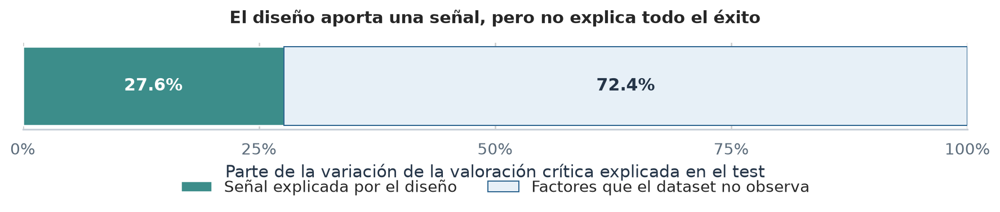
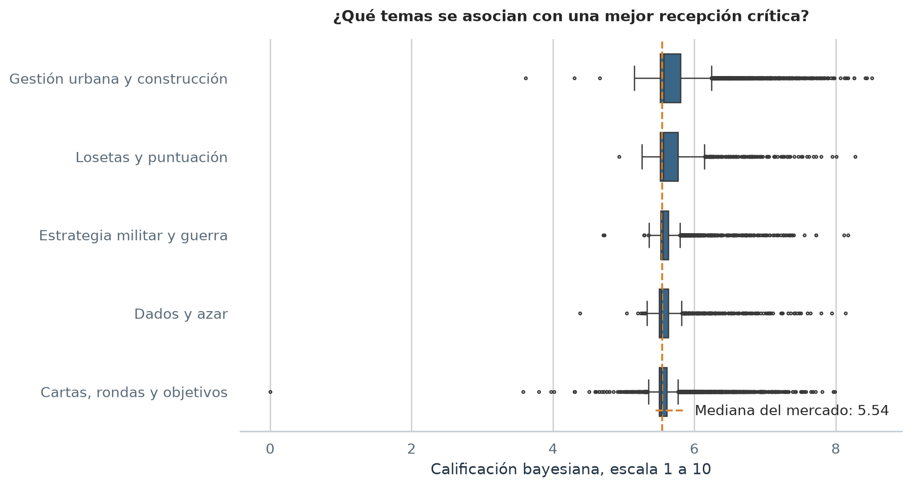
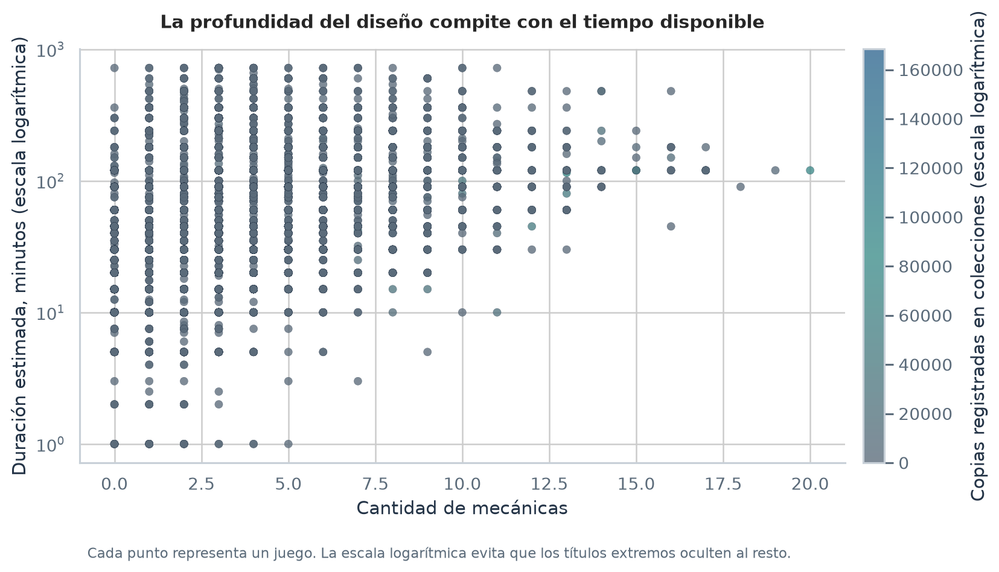
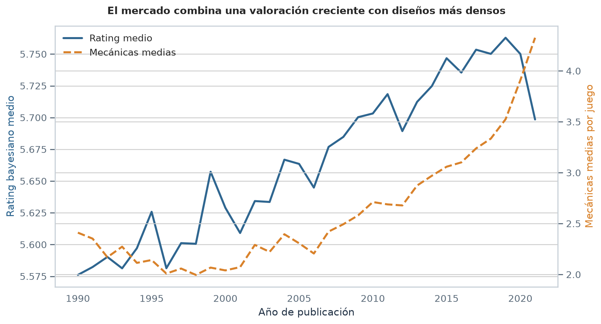
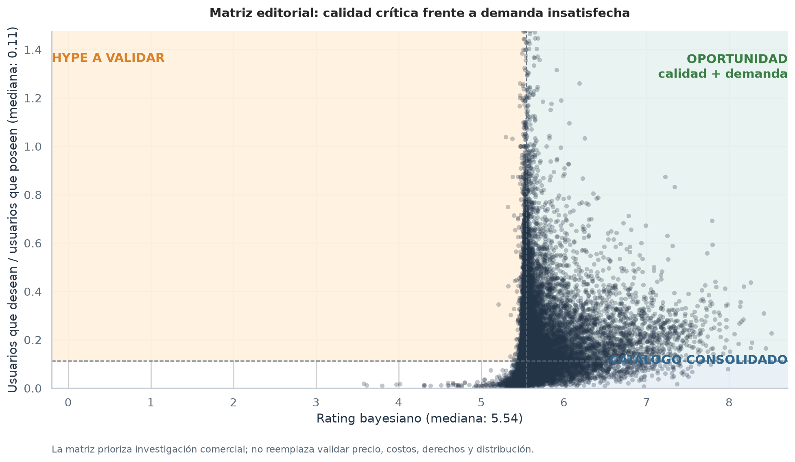
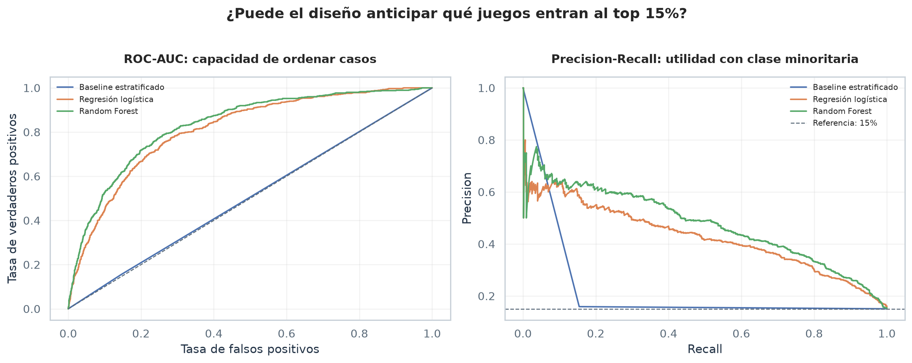

# Board Games Market Intelligence

## De datos de juegos de mesa a decisiones editoriales
Este proyecto analiza el catálogo de BoardGameGeek para responder una pregunta concreta:

> **Antes de producir un juego, ¿qué señales del diseño ayudan a estimar su recepción crítica y dónde aparecen oportunidades editoriales?**
El trabajo combina integración y limpieza de datos, procesamiento de lenguaje natural, segmentación de productos y modelos predictivos. Está pensado como un caso de portfolio: cada decisión se explica, cada resultado se puede reproducir y las conclusiones distinguen entre evidencia y recomendación.

## Resumen para cualquier público
Un editor necesita decidir qué prototipos merecen más investigación, desarrollo o inversión. El análisis usa información disponible antes del lanzamiento, como cantidad de jugadores, duración, edad recomendada, mecánicas y categorías. Después compara esas características con la valoración y la adopción observadas en BoardGameGeek.

La conclusión principal es equilibrada: **el diseño aporta una señal útil, pero no alcanza para predecir por sí solo el éxito comercial**. Arte, precio, calidad de componentes, marketing, distribución y comunidad también importan y no están representados en este dataset.

### La idea en una imagen

Esta es la lectura más importante del proyecto para una audiencia no técnica: el diseño ayuda a orientar la decisión, pero no reemplaza validar el mercado.



## Resultados principales

La ejecución actual del pipeline produce 21.475 juegos después de integrar las fuentes, filtrar registros con menos de 30 valoraciones y sanear campos físicos. En la integración original se observan 21.831 registros de ratings, 21.631 registros de detalles y 200 IDs sin correspondencia completa.
### Evidencia cuantitativa

| Pregunta | Resultado medido | Lectura sencilla |
| --- | --- | --- |
| ¿Qué tan informativo es el diseño para explicar la valoración? | Gradient Boosting: $R^2 = 0.283$; MAE = 0.179 | Las variables de diseño explican una parte relevante, pero la mayor parte de la variación queda fuera del modelo |
| ¿Se puede ordenar el potencial de entrar al top 15%? | Random Forest: ROC-AUC = 0.831; Average Precision = 0.473 | El modelo separa mejor que el azar, aunque todavía requiere validación editorial |
| ¿Qué ocurre con la clase minoritaria? | El top 15% representa la referencia de Average Precision | Por eso se informa Precision-Recall además de ROC-AUC |
| ¿Qué patrones temáticos aparecen? | NMF identifica construcción urbana, guerra, cartas, dados y colocación de losetas | Son agrupaciones descriptivas, no etiquetas objetivas de género |

Estas métricas se obtuvieron con una partición estratificada 80/20 y `random_state=42`. Se deben volver a calcular si cambia la fuente o el pipeline.
## Resultados visuales

### Tópicos y recepción crítica
La extracción TF-IDF + NMF agrupa palabras frecuentes de las descripciones. Los grupos se ordenan por mediana de calificación para facilitar la comparación, sin afirmar causalidad.


### Complejidad, duración y adopción

Cada punto es un juego. La escala logarítmica permite ver simultáneamente títulos cortos y títulos de muchas horas; el color representa la cantidad de copias registradas en colecciones.


### Evolución del mercado

Se comparan dos tendencias con escalas separadas: valoración media y cantidad media de mecánicas. La figura describe una evolución conjunta, no demuestra que una variable cause la otra.


### Matriz de oportunidad editorial

La matriz cruza recepción crítica con demanda relativa no satisfecha, calculada como `wishing / (owned + 1)`. El cuadrante de oportunidad sirve para priorizar investigación de licencias o reimpresiones; no reemplaza estudiar costos, derechos, precio y distribución.


### Modelo predictivo

Se muestran ROC-AUC y Precision-Recall para no ocultar el efecto del desbalance entre el 15% superior y el resto del catálogo.



La figura ejecutiva es la recomendada para una presentación general. Las curvas ROC y Precision-Recall quedan como respaldo técnico para una entrevista o revisión metodológica.
## Cómo se construyó el análisis

### 1. Integración y calidad de datos
Se combinan `ratings.csv` y `details.csv` usando `id`. Se elige un inner join porque un registro sin detalles de diseño no permite analizar mecánicas, duración o categorías sin inventar información. Los años se consolidan usando el valor válido más antiguo, se conservan juegos históricos con una bandera específica y se corrigen rangos de jugadores invertidos.

También se aplica:
- un mínimo de 30 valoraciones para reducir la inestabilidad de muestras muy pequeñas;
- imputación de duración a partir de `minplaytime` y `maxplaytime` cuando es posible;
- exclusión de duraciones superiores a 720 minutos para evitar que casos extremos dominen el análisis comercial;
- marcado y limitación de `maxplayers` superiores a 20 para que pocos valores extremos no creen perfiles artificiales;
- parseo seguro de listas y creación de `num_mecanicas` y `num_categorias`.

La implementación está en [data_cleaning.py](data_cleaning.py).
### 2. Lenguaje natural

Las descripciones se limpian de HTML, entidades y ruido. TF-IDF transforma el texto en pesos comparables y NMF encuentra combinaciones de palabras que aparecen juntas. Las etiquetas de los tópicos se asignan después de inspeccionar sus palabras más representativas, porque el número interno de un tópico no tiene significado por sí mismo.

La implementación está en [text_processing.py](text_processing.py).
### 3. Modelos sin fuga de información

El objetivo de clasificación es pertenecer al 15% superior de `bayes_average`. El modelo solo usa atributos disponibles antes del lanzamiento:

`minplayers`, `maxplayers`, `playingtime`, `minage`, `num_mecanicas`, `num_categorias`, mecánicas frecuentes y categorías frecuentes.
Se excluyen deliberadamente `owned`, `users_rated`, `wishing`, `wanting`, `trading` y `rank`, porque aparecen después de que el juego llega al mercado. Además, los vocabularios y escaladores se ajustan solo con el conjunto de entrenamiento.

La implementación está en [modeling.py](modeling.py). La evaluación informa regresión, ROC-AUC, Average Precision e importancia relativa de variables.
### 4. Comunicación visual

Los gráficos se generan desde [visualization.py](visualization.py), con una paleta consistente, títulos en lenguaje de decisión, medianas visibles y notas de interpretación. Esto evita que el notebook dependa de bloques de código visual duplicados.

## Estructura del repositorio

```text
.
├── board_games_market_intelligence_report.ipynb      # Notebook principal para entregar
├── data_cleaning.py                                  # Descarga, integración y saneamiento
├── text_processing.py                                # Limpieza de texto y NMF
├── modeling.py                                       # Preparación y evaluación predictiva
├── segmentation.py                                   # Selección de k y perfiles de producto
├── visualization.py                                  # Gráficos reutilizables
├── generate_figures.py                               # Generación de imágenes del README
├── requirements.txt                                  # Dependencias reproducibles
├── docs/figures/                                     # Visualizaciones versionadas
├── README.md                                         # Documentación del proyecto
└── .gitignore                                        # Archivos locales y generados excluidos
```

## Reproducibilidad

### 1. Crear el entorno
Se recomienda Python 3.10 o superior.

```bash
python -m venv .venv
```

En Windows PowerShell:
```powershell
.\.venv\Scripts\Activate.ps1
```

### 2. Instalar dependencias
```bash
python -m pip install --upgrade pip
python -m pip install -r requirements.txt
python -c "import nltk; nltk.download('stopwords')"
```

### 3. Ejecutar el pipeline
```bash
python data_cleaning.py
python generate_figures.py
```

El primer comando descarga las fuentes y genera `juegos_limpios.csv`. El segundo actualiza las imágenes de `docs/figures/` y recalcula las métricas de modelado.
### 4. Explorar el informe

El entregable autónomo es [board_games_market_intelligence_report.ipynb](board_games_market_intelligence_report.ipynb). Contiene la carga oficial de datos, las funciones de limpieza, el análisis exploratorio, el modelado de tópicos, el agrupamiento, los modelos, las visualizaciones y las conclusiones dentro del propio archivo.

## Limitaciones y uso responsable

- BoardGameGeek representa principalmente a una comunidad de aficionados y no a todo el mercado retail.
- La fuente es un corte temporal de enero de 2022.
- No se observan precio, costos, componentes, arte, marketing, distribución ni desempeño financiero.
- Las asociaciones descriptivas no prueban causalidad.
- Las importancias de Random Forest ayudan a priorizar hipótesis, pero no deben interpretarse como efectos causales.

Por estas razones, el resultado debe usarse como **filtro inicial de decisión**, no como aprobación automática de una tirada de producción.
## Fuente de datos

Los datos provienen del [dataset de BoardGameGeek de TidyTuesday](https://github.com/rfordatascience/tidytuesday/tree/master/data/2022/2022-01-25). Revisar la documentación original antes de redistribuir los archivos de datos.

## Autor

**Ariel Martinez**  
Data analysis, data cleaning, NLP, segmentation and predictive modeling.
